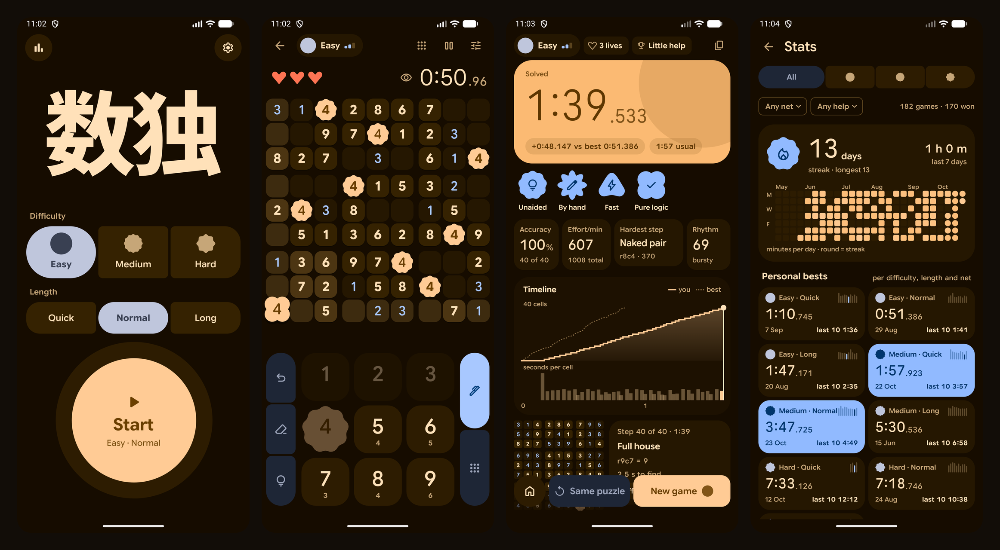

# Material Sudoku

An offline Sudoku for Android, built in Material 3 Expressive. No ads, no accounts, no network.

- Seven difficulties, from scanning-only Easy to famous "impossible" puzzles, each in three lengths
- Every puzzle generated on the phone, graded by the hardest technique it needs
- Shape-morphing tiles, rich haptics, a ms timer, graded hints
- Stats from a full move log: bests, streaks, history, accuracy, effort

**Download:** the APK is under [Releases](../../releases). Android 12+.

**Build:** `./gradlew assembleRelease` · tests: `./gradlew :app:testDebugUnitTest`
